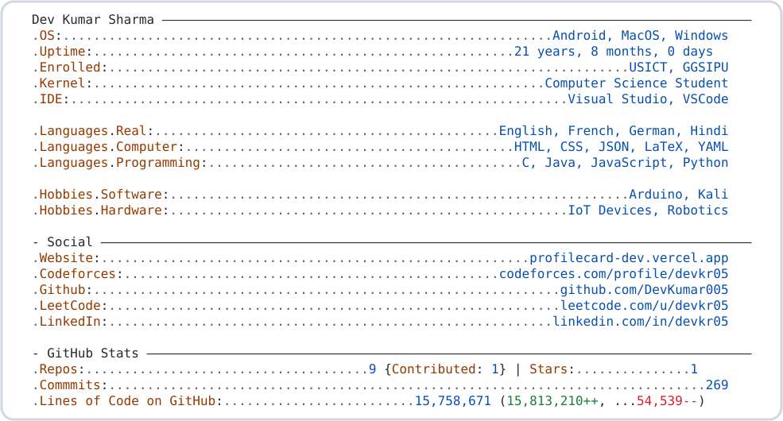

### Hi there 👋

<picture>
  <source media="(prefers-color-scheme: dark)" srcset="dark_mode.svg">
  <source media="(prefers-color-scheme: light)" srcset="light_mode.svg">
  
</picture>

---

## 🤝 Contributions

Here are some repositories I’ve contributed to:

- [CogniPlant](https://github.com/DEADEND-47/CogniPlant) — Contributed to the backend and AI systems, including RAG, NLP pipelines, knowledge graphs, and compliance workflows.

- [FactFinder](https://github.com/anuragkumar80/FactFinder) — Contributed to AI development and integration, working on intelligent search, AI-powered analysis, natural language processing, and relevant response generation for fact verification.

- [SeeGuide](https://github.com/DEADEND-47/SeeGuide) -

- [GuardPay](https://github.com/Rohit-pal01/GuardPay) - Led overall project architecture and technical integration, developed the frontend and interactive shopping workspace, including live audit timelines and approval modals, and handled API client integration, deployment configuration, and demo flow.

More contributions will be added as I continue contributing to open-source projects.

---

## 📜 License & Credits

The code in this repository, including the Python script (`main.py`) and all SVG files, was custom-built. It is public for portfolio purposes only.

While you are welcome to use it for inspiration, please **do not make a direct copy**. I would appreciate it if you built your own version. If you do adapt any of the logic for your own profile, please provide clear attribution back to this repository.
